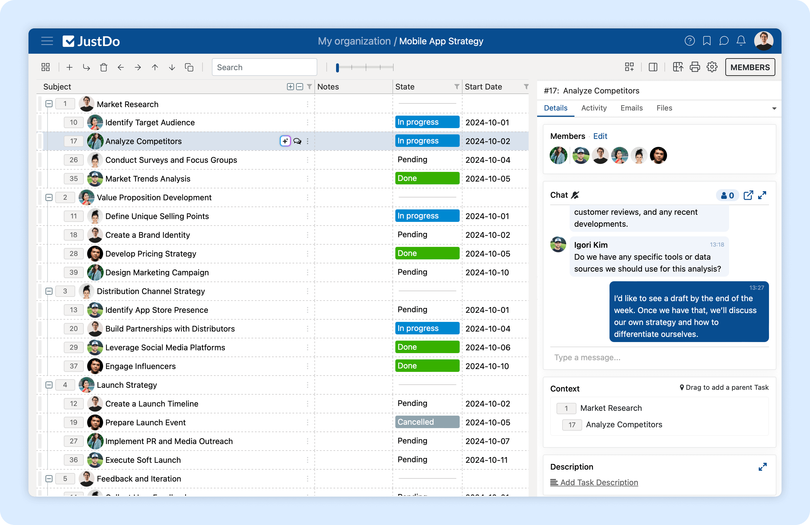

  

# Enterprise project and portfolio management

JustDo brings project planning, portfolio visibility and team collaboration into one workspace. Connect day-to-day work with the priorities that matter to your organization.

**[Explore JustDo](https://justdo.com) · [Request a demo](https://justdo.com/contact) · [Browse features](https://justdo.com/features)**

## Plan, coordinate and deliver

- **See the portfolio:** bring projects together with dashboards and shared reporting.
- **Build the plan:** organize work into task hierarchies, Gantt schedules, dependencies and milestones.
- **Coordinate resources:** track capacity, time and project costs across teams.
- **Keep work and conversations together:** collaborate around tasks, files and updates with the right people.
- **Support international teams:** work across languages, including right-to-left interfaces.
- **Use AI in your workflow:** turn prompts and documents into project structures and summarize project information.

## Deployment for your organization

Discuss cloud, on-premises and intranet deployment options with our team, along with your integration, access and implementation requirements.

[Talk to JustDo](https://justdo.com/contact) about your use case and arrange a demonstration for your team.

## Product information and support

This is JustDo's official product information and resources repository.

| Looking for | Go to |
| --- | --- |
| Product overview | [justdo.com](https://justdo.com) |
| Capabilities | [Features](https://justdo.com/features) |
| Demonstrations and business inquiries | [Contact JustDo](https://justdo.com/contact) · [info@justdo.com](mailto:info@justdo.com) |
| Technical support | [support@justdo.com](mailto:support@justdo.com) |
| Legal information | [Terms and Conditions](https://justdo.com/terms-and-conditions) · [Privacy Policy](https://justdo.com/privacy-policy) |

© 2026 JustDo, Inc. All rights reserved.
